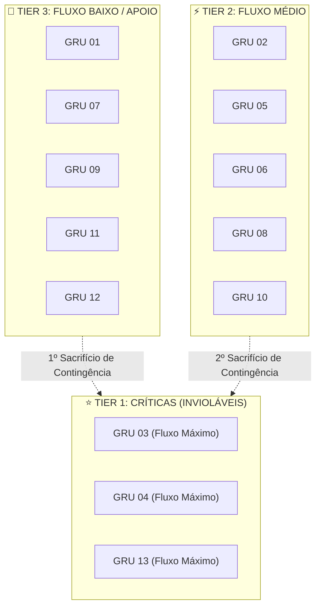
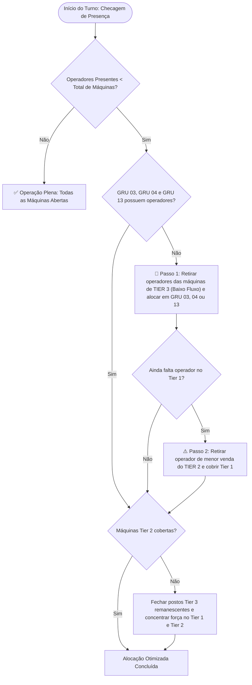

# 📋 Especificação Arquitetural: Alocação de Máquinas & Gestão de Contingência
**Protecbag — Aeroporto Internacional de São Paulo (GRU Airport)**  
*Planejamento Operacional para Alta Temporada (Dezembro/2026)*

---

## 1. Visão Geral & Diretriz Operacional

Em Dezembro, com a alta temporada de férias e festas de fim de ano, o fluxo de passageiros e a demanda por proteção/envelopamento de bagagens em GRU atinge o pico anual. 

Para maximizar a receita e evitar perda de vendas em pontos estratégicos, a gestão operacional estabeleceu uma **Regra de Ouro**:
> **Regra de Ouro (Inviolabilidade de Postos Críticos):**  
> As máquinas **GRU 03**, **GRU 04** e **GRU 13** **NUNCA** podem permanecer fechadas se houver contingente disponível.  
> Em qualquer cenário de contingência (faltas, atrasos, licenças ou quadro reduzido), os operadores devem ser remanejados seguindo rigorosamente a **cascata de prioridade de fluxo**, sacrificando primeiro postos de fluxo baixo e, no limite, postos de fluxo médio.

---

## 2. Classificação Hierárquica de Máquinas por Fluxo

### Detalhamento dos Níveis:

| Nível | Postos / Máquinas | Regra de Operação | Comportamento em Contingência |
| :--- | :--- | :--- | :--- |
| **Tier 1 (Críticas)** | **GRU 03, GRU 04, GRU 13** | **Prioridade Máxima**. Devem operar em 100% dos turnos. | **Últimas a fechar**. Recebem operadores remanejados de outros postos. |
| **Tier 2 (Médio Fluxo)** | **GRU 06, GRU 08, GRU 02, GRU 05, GRU 10** | Operação padrão regular. | Só cedem operador se todo o Tier 3 já tiver sido remanejado. |
| **Tier 3 (Baixo Fluxo)** | **GRU 01, GRU 07, GRU 09, GRU 11, GRU 12** | Postos de suporte e apoio. | **Primeiros a ceder operadores** para garantir abertura do Tier 1 e Tier 2. |

> [!IMPORTANT]
> A classificação de máquinas de Tier 2 e Tier 3 pode ser calibrada dinamicamente conforme a localização dos terminais (Terminal 2 vs. Terminal 3) e o histórico de vendas registrado no OneBoss.

---

## 3. Algoritmo de Remanejamento em Cascata (Fallback Inteligente)

Quando o líder de turno ou o gestor abre o turno no sistema e informa o número de operadores presentes:

---

## 4. Estrutura do Novo Painel (Wireframe & Funcionalidades)

Para o lançamento em **Dezembro/2026**, o portal `escala-gru` receberá a aba dedicada **"🗺️ Postos & Máquinas"**:

### Componentes Planejados:
1. **Quadro Visual de Máquinas (Cards Interativos):**
   - Identificação da Máquina (`GRU 03`, `GRU 04`, `GRU 13` destacados com selo ⭐ `Posto Crítico`).
   - Status visual:
     - 🟢 **Aberta / Operando** (Operador alocado).
     - 🟡 **Apoio Ativo** (Volante cobrindo pausa/almoço).
     - 🔴 **Fechada por Contingência** (Com indicação: *"Operador remanejado para GRU 04"*).
2. **Quadro de Apoio / Volantes:**
   - Lista dos colaboradores escalados como "Apoio" no dia.
   - Rotatividade programada para cobertura de almoço das máquinas Tier 1 e abastecimento de insumos (bobinas de plástico).
3. **Simulador de Falta em Tempo Real:**
   - O líder marca: *"Faltou 1 operador no Turno A"*.
   - O sistema sugere imediatamente:  
     👉 *"Feche GRU 11 (Baixo Fluxo) e mantenha GRU 03, GRU 04 e GRU 13 abertas."*

---

## 5. Cronograma de Implantação (Preparação para Dezembro)

| Etapa | Período | Entregáveis |
| :--- | :--- | :--- |
| **Fase 1: Mapeamento dos Postos** | Novembro/2026 (Semana 4) | Cadastro formal de todas as máquinas, terminais (T2 Asa A/B/C/D, T3) e classificação de fluxo. |
| **Fase 2: Motor de Alocação** | Final de Novembro/2026 | Desenvolvimento da lógica JavaScript e interface no `index.html`. |
| **Fase 3: Escala Oficial de Dezembro** | Assim que o Gerente liberar | Importação da escala oficial via `Atualizar_Escala_Dezembro.bat`. |
| **Fase 4: Go-Live Alta Temporada** | 01/Dezembro/2026 | Sistema operando 100% com regras de fluxo e contingência ativas. |

---

> [!TIP]
> Essa especificação já fica salva e documentada no repositório do projeto, garantindo que a regra de negócio esteja 100% preservada para a implementação de Dezembro.
